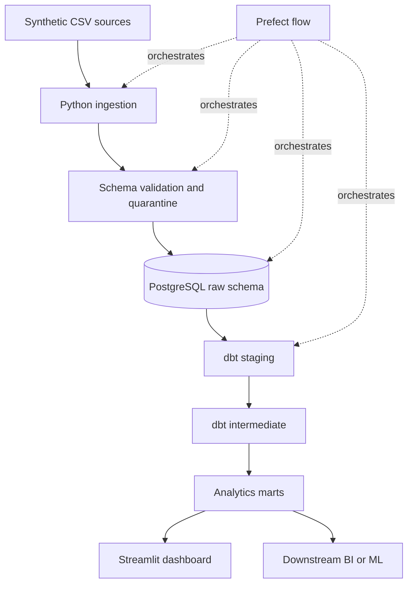
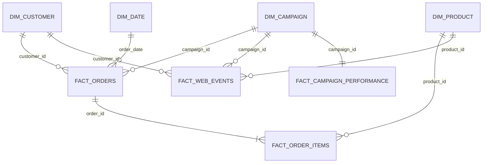

# Creative Commerce Intelligence Pipeline

A production-style Python and SQL data engineering platform for multi-source commerce, campaign, customer, and product analytics.

## Overview

This project models the data platform of a fictional direct-to-consumer brand. It generates relational synthetic source data, validates and quarantines records, loads idempotent batches into PostgreSQL, and uses dbt to publish dimensional models and analytics marts. Prefect coordinates the workflow; Streamlit is a lightweight consumer of the resulting marts.

It demonstrates Python ingestion, queryable batch lineage, idempotent incremental loading, PostgreSQL, SQL/dbt modeling, data-quality controls, orchestration, Docker, and CI. Production-like behavior comes from transactional loads, source-key overlap handling, explicit quarantine reasons, reconciliation, and structured run summaries—not from infrastructure breadth.

All customer identifiers and activity are synthetic. The repository contains no real customer data or credentials.

## Business Problem

Commerce, CRM, campaign, and website systems use different grains and schemas. The pipeline turns those sources into tested datasets for revenue trends, product margin, customer lifetime value, campaign ROAS and CAC, cohort retention, and conversion-funnel analysis.

## Architecture



## Data Sources

The deterministic generator creates approximately 2,000 customers, 100 products, 5,500 orders, more than 10,000 order items, 40 campaigns, and 45,000 website events. Files follow Shopify-style commerce, advertising, CRM, and web-event conventions without names, email addresses, or other PII.

## Pipeline

1. Discover source CSVs and calculate SHA-256 file hashes.
2. Validate the required schema and row-level business rules.
3. Write invalid rows to a quarantine area with failure reasons.
4. Add batch lineage columns and append new primary keys to PostgreSQL.
5. Record batch status, source filename, counts, hash, timestamp, and quality results.
6. Run the dbt build and its data tests.

Repeated files are skipped through a unique `(source, file_hash)` batch constraint. A changed file is a new batch, while existing source primary keys are filtered before append. Failures are raised rather than silently ignored.

The queryable `raw.ingestion_batches` table stores source file and type, batch ID, SHA-256 hash, ingestion time, source/valid/quarantined/loaded counts, status, and failure detail. For a changed file, reconciliation requires `valid rows = loaded rows + previously seen keys`.

## Data Quality

Pydantic checks IDs, dates, status and event domains, nonnegative financial values, product price versus cost, and campaign funnel constraints. Duplicate primary keys are quarantined. Quarantine rows retain explicit rule names such as `PRODUCT_COST_GT_PRICE`, `CAMPAIGN_FUNNEL_INCONSISTENT`, and `DUPLICATE_PRIMARY_KEY`. Each batch writes a JSON report containing processed, valid, invalid, duplicate, missing-value, and validation-failure counts.

## Data Model

The warehouse uses `raw`, `staging`, `intermediate`, and `analytics` schemas. Analytics follows a star design:

- Dimensions: customer, product, campaign, and date
- Facts: orders, order items, web events, and campaign performance
- Marts: daily revenue, campaign performance, customer LTV, cohorts, product performance, and conversion funnel



## dbt Transformation Layer

SQL models use CTEs, joins, `CASE` expressions, conditional aggregation, window functions, running totals, seven-day averages, date arithmetic, cohort indexing, ranking, and incremental materialization. dbt tests cover uniqueness, required values, relationships, accepted values, nonnegative revenue, cohort bounds, and campaign funnel consistency.

## Analytics Marts

Metric assumptions are explicit: revenue includes completed orders; AOV is completed revenue divided by completed orders; ROAS is attributed order revenue divided by campaign spend; CAC is spend divided by distinct attributed customers; repeat rate uses customers with more than one completed order; `observed_lifetime_revenue` is historical completed revenue, not predicted LTV.

Cohort month is the customer's first completed-purchase month. Activity month is each later month with a completed purchase; retention is distinct active purchasers divided by the original first-purchase cohort size.

Attribution uses the source-provided campaign ID on each completed order as a simple last-touch field. Missing campaign IDs are grouped as `DIRECT_OR_UNKNOWN`. There is no separate lookback window because the synthetic order source supplies the final campaign association directly. This is intentionally not multi-touch attribution.

## Dashboard

The Streamlit dashboard has Overview, Campaign Performance, Customer Analytics, Product Performance, and Conversion Funnel views. It queries dbt marts rather than duplicating transformations in Python.

<!-- Add portfolio screenshots to docs/images/: overview.png, campaigns.png, customers.png, funnel.png -->

## Tech Stack

Python 3.11+, PostgreSQL 16, SQLAlchemy, Pandas, Pydantic, dbt Core, dbt-postgres, Prefect, Streamlit, Plotly, pytest, Docker Compose, and GitHub Actions.

## Project Structure

```text
pipeline/     ingestion, validation, loading, orchestration, and metrics
dbt/          staging, intermediate, mart models, and data tests
dashboard/    Streamlit analytics interface
scripts/      data generation and pipeline entry points
tests/        unit and SQLite-backed integration tests
data/         ignored runtime source and processed files
outputs/      ignored quality and pipeline reports
```

## Running Locally

```bash
python -m venv .venv
source .venv/bin/activate
pip install -r requirements.txt
cp .env.example .env
docker compose up -d postgres
python scripts/run_pipeline.py --generate
```

`DATABASE_URL` is environment-driven. The included value is a local-only Docker credential; supply a managed PostgreSQL URL in another environment.

## Running the Pipeline

```bash
python scripts/generate_synthetic_data.py
python scripts/run_pipeline.py
```

The second command runs validation, quarantine handling, raw loading, and `dbt build` inside one Prefect flow.

Every run writes `outputs/pipeline_run_<run_id>.json` with timestamps, duration, record totals, skipped batches, dbt status, quality status, overall status, and a failure reason when applicable.

## Incremental Load Demo

After the initial load, generate and process a dated batch:

```bash
python scripts/run_pipeline.py --daily 2026-01-02
```

Run the same command again to observe file-hash duplicate protection. The daily generator preserves existing full-load files and creates date-suffixed sources.

Verified offline loader example:

- Initial load: 66,341 rows
- Exact rerun: 0 rows loaded; 6 identical batches skipped
- Incremental daily batch: 1,860 new rows

Tests also cover changed files containing only known keys and changed files containing both overlapping and new keys.

## Testing

```bash
pytest -q
dbt test --project-dir dbt --profiles-dir dbt
```

The Python suite covers deterministic generation, validation, quarantine, hashing, incremental loading, duplicate batches, and metric calculations. dbt tests require the populated PostgreSQL warehouse.

## Docker

```bash
docker compose up -d postgres
docker compose build dashboard
docker compose up dashboard
```

The dashboard is available at `http://localhost:8501`. Runtime data, `.env`, caches, and database files are excluded from the image and Git.

## Limitations

- Attribution is last-touch by campaign ID and does not resolve cross-device identity.
- Observed customer value is historical revenue rather than a predictive estimate.
- CSV discovery represents batch sources; production systems would use object storage, CDC, or APIs.
- Synthetic behavior is useful for engineering demonstrations, not business benchmarking.

## Future Improvements

- Object-storage landing zone and event-driven ingestion
- Slowly changing customer and product dimensions
- Partitioning and warehouse-specific performance tests at larger scale
- Data contracts and lineage publishing in a managed deployment

## Author

Yi Xin Ding
